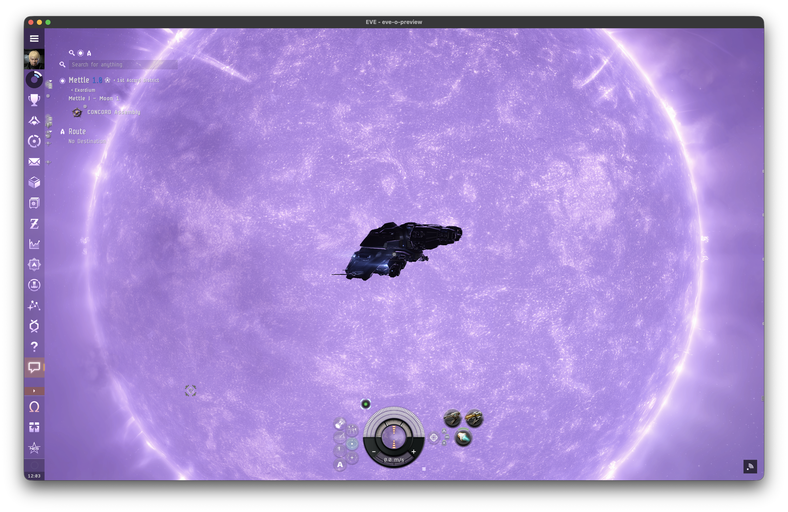

# EVE-O Preview for macOS


`EVE-O Preview for macOS` is a lightweight companion app for EVE Online multiboxing on macOS.

It helps you keep track of multiple running clients with live preview overlays and quick client switching, while staying focused on a simple, practical workflow.

## Screenshots

Main app window:


EVE Online on macOS:



## What it does

- detects running EVE Online clients
- shows live thumbnail previews
- lets you click a preview to focus the matching client
- remembers thumbnail positions
- saves local app settings
- ships as a ready-to-test macOS `.app` and `.dmg`

## Built for macOS

This project is a dedicated macOS implementation built with:

- .NET 8
- Avalonia UI
- CoreGraphics for client discovery
- ScreenCaptureKit for native window preview streams
- AppleScript / System Events as a client activation fallback

## How to use

1. Start one or more EVE Online clients.
2. Launch `EVE-O Preview for macOS`.
3. Allow macOS permissions if prompted.
4. Use the main window to detect clients and manage settings.
5. Click a floating preview to bring the matching client to the front.

## Build

Requires macOS 12.3 or later, the .NET 8 SDK, and Xcode Command Line Tools.
The build compiles an Objective-C ScreenCaptureKit bridge for the selected architecture.

From the repository root:

```bash
./mac/scripts/build-dmg.sh
```

Build output:

- `mac/dist/EVE-O Preview.app`
- `mac/dist/eve-o-preview-mac-osx-arm64.dmg`

Optional Intel build:

```bash
RUNTIME=osx-x64 ./mac/scripts/build-dmg.sh
```

## macOS permissions

Depending on your macOS settings, the app may request access to:

- Accessibility
- Automation
- Screen Recording

Screen Recording is required for window titles and preview capture. Use **Set up Screen Recording** in the Config tab to request permission or open the matching System Settings page. Accessibility and Automation may be needed for the client activation fallback; client discovery no longer waits for System Events.

Preview streams deliver up to 15 frames per second at thumbnail resolution. The app keeps the latest frame and reuses its display bitmap. Capture errors and missing Screen Recording permission appear inside the affected preview. After granting permission, reopen the app if macOS requests it.

### Native capture checks

From the repository root, build and run the buffer-copy and stream-lifecycle checks.

```bash
xcrun clang -mmacosx-version-min=12.3 -O2 -fobjc-arc -fblocks \
  mac/tests/WindowCaptureTests.m \
  -framework Foundation -framework AppKit -framework ScreenCaptureKit \
  -framework CoreGraphics -framework CoreMedia -framework CoreVideo \
  -o /tmp/eve-native-capture-tests
/tmp/eve-native-capture-tests --live
```

The live check captures only its own test window. It is skipped when Screen Recording permission is unavailable.

## Project status

This is an early public macOS release focused on the core experience:

- find running EVE clients
- preview them live
- switch between them quickly

## Known limitations

- this is still an early macOS release
- some settings are visible but not implemented yet
- feature parity with the Windows ecosystem is not complete
- Apple Silicon build is the default packaged output

## Credits

- macOS port and current project work by `SihKic`
- inspired by the original `EVE-O Preview` idea and workflow created by the wider EVE multiboxing community

## Support

If this project is useful to you and you would like to support it, ISK donations are welcome in EVE Online.

- in-game character: `SihKic`

## Release

Current packaged build output:

- `mac/dist/eve-o-preview-mac-osx-arm64.dmg`

To release version X.Y.Z:

1. Set `<Version>X.Y.Z</Version>` in `mac/EveOPreview.Mac/EveOPreview.Mac.csproj`. This is the only place the version is defined.
2. Run `./mac/scripts/build-dmg.sh`. It copies the version into the app bundle, and **About EVE-O Preview** shows it.
3. Attach `mac/dist/eve-o-preview-mac-osx-arm64.dmg` to a GitHub release tagged `vX.Y.Z`.
